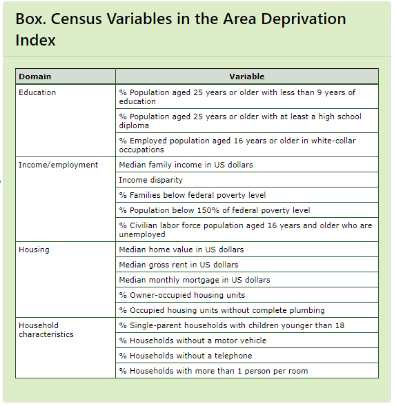
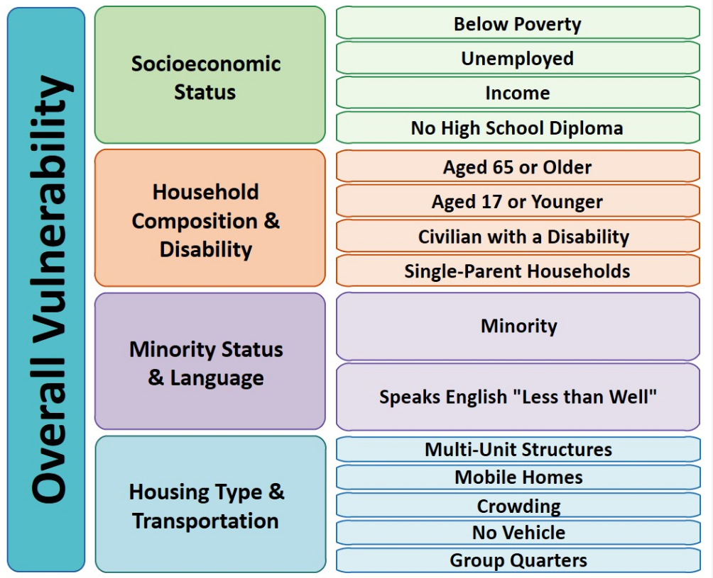

```{r setup, include=FALSE}
knitr::opts_chunk$set(echo = TRUE)
```

## **Index Replicator**

The goal of this script is to replicate a variety of vulnerability indices for Henry County, GA. These indices utilize primarily census and acs-5 data, however there are a few indices that use EPA and other environmental data as well.

Current indices replicated

- Area Deprivation Index: 2019
- Social Vulnerability Index: 2020
  
Planned indices to replicate:

- Environmental Justice Index
  
Please refer to the respective subsections to understand the process behind replicating indices, and which variables were used.


```{r, include = FALSE, echo = FALSE}
#Vector of all required packages for this project
packages <- c('tidyverse', 'sf', 'tidycensus', 'tmap', 'tigris')

#For each package we need...
for(p in packages){
  print(p)
  
  #If we do not  have the package
  if(!(p %in% installed.packages())){
    install.packages(p)
  }
}

#Library in the packages
sapply(X = packages, FUN = library, character.only = TRUE)
```

### **Load in Census Variable Codebook and Activate API Key**

We will use this to lookup variables for both ACS and Census data to craft indices

```{R, message = FALSE}
census_api_key('cf3c51073f5e6be8f75b96e5c12662a25525326b')

#ACS Variable and Concept Lookups
acs_codebook <- load_variables(2020, 'acs5')
acs_concepts <- acs_codebook %>%
  count(concept, name = 'Number of Variables')

#ACS Profile variables and Concept lookups
acsprofile_codebook <- load_variables(2020, 'acs5/profile')
acsprofile_concepts <- acsprofile_codebook %>%
  count(concept, name = 'Number of Variables')

#ACS CProfile Variables and Concept lookups
acscprofile_codebook <- load_variables(2020, 'acs5/cprofile')
acscprofile_concepts <- acscprofile_codebook %>%
  count(concept, name = 'Number of Variables')

#ACS Subject Variables and Concept lookups
acssubject_codebook <- load_variables(2020, 'acs5/subject')
acssubject_concepts <- acssubject_codebook %>%
  count(concept, name = 'Number of Variables')

#Census Variable and Concept Lookups
census_codebook <- load_variables(2020, 'pl')
census_concepts <- census_codebook %>%
  count(concept, name = 'Number of Variables')

head(acs_codebook)
```

### **Get Henry County Geometries**

Load in geometries for Henry County and fix the coordinate reference systems. Geometries are pulled based on index geometry.
All geometries are converted to the NAD 1983 Georgia West projection, epsg = 26967

```{R, results = 'hide'}

#We will be using the NAD 1983 Georgia West projection
epsg_id <- 26967

#Load in block group geometry for 2019
#For the ADI, we are using 2019 data because the most recent ADI indices use 2019 ACS data
henry_block_group_2019_geometry <- tigris::block_groups(state = 'GA', county = 'Henry County', year = 2019) %>%
  st_transform(epsg_id)

#SVI is calculated using ACS 5 year 2016-2020 estimates
henry_tract_2020_geometry <- tigris::tracts(state = 'GA', county = 'Henry County', year = 2020) %>%
  st_transform(epsg_id)
```

### **Load in Area Deprivation Index for Henry County**

Unfortunately the methodology for calculating the ADI was not well defined, therefore I am not able to reproduce it here. Hopefully I will be able to reproduce it in the near future.


Data was downloaded from ('https://www.neighborhoodatlas.medicine.wisc.edu/').




The variables in the adi_raw dataset mean the following:

* GISJOIN: Key linkage field to the block group shapefile served by NHGIS
* FIPS: The block group Census ID
* ADI_NATRANK: National percentile of block group ADI score
* ADI_STATERNK: State-specific decile of block group ADI score
  
```{R}
#Read in data
adi_raw <- read_csv('./Data/GA_2019_ADI_Census Block Group_v3.1.csv') %>%
  select(-c(...1,...2)) %>%
  mutate(GEOID = as.character(FIPS))

#Merge data with block group geometry
adi_henry <- merge(henry_block_group_2019_geometry, adi_raw, by = 'GEOID') %>%
  
  #Update state rank variable to factor
  mutate(ADI_STATERNK = factor(ADI_STATERNK, ordered = TRUE)) %>%
  
  #Convert the national rank variable to numeric
  mutate(ADI_NATRANK = as.numeric(ADI_NATRANK))
```

### **Calculate SVI Index for Henry County**

Fortunately this index is replicable in R. Documentation for calculating the SVI can be found [here]('https://www.atsdr.cdc.gov/placeandhealth/svi/documentation/SVI_documentation_2018.html') 





The SVI is calculated in the following way:

* For each variable, calculate the percentile of each tract within the state (in this case we use the state of Georgia)
* Add variable percentiles together to calculate a "score" for each category shown in the figure above.
* Calculate percentiles for each score.
* Add raw scores of each category together to determine the final score
* Calculate percentiles for the final score (the SVI)
* If the SVI is greater than 90, the tract is considered 1 - "high vulnerability", otherwise it is considered 0 - "low vulnerability"

First, we need to pull in the applicable variables from the ACS
```{R}
svi_vars <- c(
  'Population' = 'S0601_C01_001',
  'Housing Units' = 'DP04_0001',
  'Households' = 'DP02_0001',
  
  'Pop Below Poverty Level' = 'B17001_002',
  'Percent Below Poverty' = 'S0601_C01_049',
  'Unemployed in Labor Force' = 'DP03_0005',
  'Percent Unemployment' = 'DP03_0009P',
  'Per Capita Income' = 'B19301_001',
  'Pop with No HS Diploma' = 'B06009_002',
  'Percent No HS Diploma' = 'S0601_C01_033',
  'Pop over 65' = 'S0101_C01_030',
  'Percent over 65' = 'S0101_C02_030',
  'Pop 17 and Under' = 'B09001_001', #Divide by total population
  'Pop over 5 with Disability' = 'DP02_0071', 
  'Percent over 5 with Disability' = 'DP02_0071P',
  
  #Add together, single mother / father households with children under 18
  #Divide total by number of households
  'Female Householder, no Spouse, Children Present' = 'B11012_010',
  'Male Householder, no Spouse, Children Present' = 'B11012_015',
  
  #Subtract from total population, non-white pop
  #Divide by total pop
  'Pop Not Hispanic, White Alone' = 'B01001H_001',
  
  #Add together, number of people who speak english not well or not at all.
  #Divide total by total nativity
  'Total Nativity' = 'B16005_001',
  'Not Well 1' = 'B16005_007',
  'Not at All 1' = 'B16005_008',
  'Not Well 2' = 'B16005_012',
  'Not at All 2' = 'B16005_013',
  'Not Well 3' = 'B16005_017',
  'Not at All 3' = 'B16005_018',
  'Not Well 4' = 'B16005_022',
  'Not at All 4' = 'B16005_023',
  'Not Well 5' = 'B16005_029',
  'Not at All 5' = 'B16005_030',
  'Not Well 6' = 'B16005_034',
  'Not at All 6' = 'B16005_035',
  'Not Well 7' = 'B16005_039',
  'Not at All 7' = 'B16005_040',
  'Not Well 8' = 'B16005_044',
  'Not at All 8' = 'B16005_045',
  
  #Add together, number of structures with more than 10 units
  #Divide total by total number of units
  '10-19 Units in Structure' = 'DP04_0012',
  '20+ Units in Structure' = 'DP04_0013',
  
  'Mobile Homes' = 'DP04_0014',
  'Percent Mobile Homes' = 'DP04_0014P',
  
  #Add together then subtract from housing units, number of structures with > 1 person per room.
  #Divide by total occupancy
  'Total Occupancy' = 'DP04_0002',
  'Owner Occupied Tenure, 1.01 to 1.5  Occupants' = 'DP04_0078',
  'Owner Occupied Tenure, 1.51+ Occupants' = 'DP04_0079',
  
  'Households with no Vehicle Available' = 'DP04_0058',
  'Percent with no Vehicle Available' = 'DP04_0058P',
  
  #Divide by total population
  'Pop Group Quarters' = 'B26001_001'
)

#Get ACS5 2020 variables to compute the SVI
svi_raw <- get_acs('tract', variables = svi_vars, year = 2020, state = 'GA')
```

Now clean the data and perform necessary calculations.
```{R}
#Perform summations of specific variables to get SVI measures
svi_clean <- svi_raw %>%
  
  #Pivot the table so each census tract is its own row
  pivot_wider(names_from = `variable`, values_from = c(`estimate`, `moe`), names_sep = '.') %>%
  
  #Calculate total number and percentages of single mothers / fathers with children
  mutate('estimate.Household Single Parent with Children' = `estimate.Male Householder, no Spouse, Children Present` + `estimate.Female Householder, no Spouse, Children Present`, .keep = 'unused') %>%
  
  mutate('estimate.Percent Single Parent with Children' = round((`estimate.Household Single Parent with Children` / `estimate.Households`) * 100, 1)) %>%
  
  mutate('moe.Household Single Parent with Children' = round(sqrt(`moe.Male Householder, no Spouse, Children Present`^2 + `moe.Female Householder, no Spouse, Children Present`^2), 1), .keep = 'unused') %>%
  
  mutate('moe.Percent Single Parent with Children' = round((sqrt(`moe.Household Single Parent with Children`^2 - ((`estimate.Percent Single Parent with Children`/100)^2 * `moe.Households`^2)) / `estimate.Households`) * 100, 1)) %>%

  
  #Calculate nonwhite population and percentages
  mutate('estimate.Pop Minority Population' = `estimate.Population` - `estimate.Pop Not Hispanic, White Alone`) %>%
  
  mutate('estimate.Percent Minority Population' = round((`estimate.Pop Not Hispanic, White Alone` / `estimate.Population`) * 100, 1)) %>%
  
  mutate('moe.Pop Minority Population' = round(sqrt(`moe.Population`^2 + `moe.Pop Not Hispanic, White Alone`^2), 1)) %>%
  
  mutate('moe.Percent Minority' = round((sqrt(`moe.Pop Minority Population`^2 - ((`estimate.Percent Minority Population`/100)^2 * `moe.Population`^2)) / `estimate.Population`) * 100, 1)) %>%
  
  select(-c(`estimate.Pop Not Hispanic, White Alone`, `moe.Pop Not Hispanic, White Alone`)) %>%
  
  #Calculate low english proficiency amount and percentages
  mutate('estimate.Pop Low English Proficiency' = rowSums(across(contains(c('estimate.Not Well', 'estimate.Not at All')))), .keep = 'unused') %>%
  
  mutate('estimate.Percent Low English Proficiency' = round((`estimate.Pop Low English Proficiency` / `estimate.Total Nativity`) * 100, 1)) %>%
  
  mutate('moe.Pop Low English Proficiency' = sqrt(rowSums(across(contains(c('moe.Not Well', 'moe.Not at All')))^2)), .keep = 'unused') %>%
  
  mutate('moe.Percent Low English Proficiency' = round((sqrt(`moe.Pop Low English Proficiency`^2 - ((`estimate.Percent Low English Proficiency`/100)^2 * `moe.Total Nativity`^2)) / `estimate.Total Nativity`) * 100, 1)) %>%
  
  #Calculate number and percentages of housing structures with >10 units in structure
  mutate('estimate.10+ Units in Structure' = `estimate.10-19 Units in Structure` + `estimate.20+ Units in Structure`, .keep = 'unused') %>%
  
  mutate('estimate.Percent 10+ Units in Structure' = round((`estimate.10+ Units in Structure` / `estimate.Housing Units`) * 100, 1)) %>%
  
  mutate('moe.10+ Units in Structure' = sqrt(`moe.10-19 Units in Structure`^2 + `moe.20+ Units in Structure`^2), .keep = 'unused') %>%
  
  mutate('moe.Percent 10+ Units in Structure' = round((sqrt(`moe.10+ Units in Structure`^2 - ((`estimate.Percent 10+ Units in Structure`/100)^2 * `moe.Housing Units`^2)) / `estimate.Housing Units`) * 100, 1)) %>%
  
  #Calculate number and percentages of households where there is >1 occupant per room
  mutate('estimate.1+ Occupant per Room' = `estimate.Owner Occupied Tenure, 1.01 to 1.5  Occupants` + `estimate.Owner Occupied Tenure, 1.51+ Occupants`, .keep = 'unused') %>%
  
  mutate('estimate.Percent 1+ Occupant per Room' = round((`estimate.1+ Occupant per Room` / `estimate.Total Occupancy`) * 100, 1)) %>%
  
  mutate('moe.1+ Occupant per Room' = sqrt(`moe.Owner Occupied Tenure, 1.01 to 1.5  Occupants`^2 + `moe.Owner Occupied Tenure, 1.51+ Occupants`^2), .keep = 'unused') %>%
  
  mutate('moe.Percent 1+ Occupant per Room' = round((sqrt(`moe.1+ Occupant per Room`^2 - ((`estimate.Percent 1+ Occupant per Room`/100)^2 * `moe.Total Occupancy`^2)) / `estimate.Total Occupancy`) * 100, 1)) %>%
  
  #Calculate percentage of group quarters population
  mutate('estimate.Percent Group Quarters' = round((`estimate.Pop Group Quarters` / `estimate.Population`) * 100, 1)) %>%
  
  mutate('moe.Percent Group Quarters' = round((sqrt(`moe.Pop Group Quarters`^2 - ((`estimate.Percent Group Quarters`/100)^2 * `moe.Population`^2)) / `estimate.Population`) * 100, 1)) %>%
  
  #Calculate percentage of pop 17 and under
  mutate('estimate.Percent 17 and Under' = round((`estimate.Pop 17 and Under` / `estimate.Population`) * 100, 1)) %>%
  
  mutate('moe.Percent Pop 17 and Under' = round((sqrt(`moe.Pop 17 and Under`^2 - ((`estimate.Percent 17 and Under`/100)^2 * `moe.Population`^2)) / `estimate.Population`) * 100, 1)) %>%
  
  #Get percentiles for each estimate (within the state of Georgia)
  mutate(across(contains(c('estimate.Percent', 'estimate.Per Capita Income')), ~ signif(cume_dist(.x) * 100, 4), .names = 'percentile.{col}')) %>%
  
  #Get group scores (per the figure above).
  #These scores are the sum of the percentiles of each corresponding group variable.
  mutate('score.Socioeconomic Status' = rowSums(select(.,c(`percentile.estimate.Percent Below Poverty`, `percentile.estimate.Percent Unemployment`, `percentile.estimate.Per Capita Income`, `percentile.estimate.Percent No HS Diploma`)), na.rm = TRUE)) %>%
  
  mutate('score.Household Composition and Disability' = rowSums(select(.,c(`percentile.estimate.Percent over 65`, `percentile.estimate.Percent 17 and Under`, `percentile.estimate.Percent over 5 with Disability`, 
`percentile.estimate.Percent Single Parent with Children`)), na.rm = TRUE)) %>%
  
  mutate('score.Minority Status and Language' = rowSums(select(.,c(`percentile.estimate.Percent Minority Population`, `percentile.estimate.Percent Low English Proficiency`)), na.rm = TRUE)) %>%
  
  mutate('score.Housing Type and Transportation' = rowSums(select(.,c(`percentile.estimate.Percent 10+ Units in Structure`, `percentile.estimate.Percent Mobile Homes`, `percentile.estimate.Percent 1+ Occupant per Room`, `percentile.estimate.Percent with no Vehicle Available`, `percentile.estimate.Percent Group Quarters`)), na.rm = TRUE)) %>%
  
  #Get percentiles of scores for each group for each tract.
  mutate(across(contains('score.'), ~ signif(cume_dist(.x) * 100, 4), .names = 'percentile.{col}')) %>%
  
  #Now, sum all the score groups together to get an SVI score
  mutate('score.Total' = `score.Socioeconomic Status` + `score.Household Composition and Disability` + `score.Minority Status and Language` + `score.Housing Type and Transportation`) %>%
  
  #Get percentiles of total scores
  mutate('percentile.score.Total' = signif(cume_dist(`score.Total`) * 100, 4)) %>%
  
  #Lastly, calculate the SVI score, which is defined as the following:
  #If percentile.score.Total >= 90%, 1
  #Else 0
  mutate('svi.Flag' = if_else(`percentile.score.Total` >= 90, 1, 0))


  
```

Filter SVI GA data for Henry County
```{R}
svi_henry <- merge(henry_tract_2020_geometry, svi_clean, 'GEOID') %>%
  rename('Tract Code' = 'NAME.x', 'Full Tract Name' = 'NAME.y')

#Filter for just score variables
svi_henry_filtered <- svi_henry %>%
  select(-contains(c('estimate.', 'moe.')))
```

### **Visualize data**

All maps are saved in the Exports folder.

```{R}
tmap_mode('view')

#Create map for ADI State Rank values
adi_staterank_map <- tm_basemap('https://{s}.tile.openstreetmap.org/{z}/{x}/{y}.png') +
  tm_shape(adi_henry) +
  tm_polygons(col = 'ADI_STATERNK', alpha = 0.7, title = 'ADI Ranking Relative to State',
              popup.vars = c('Block Group' = 'NAMELSAD', 'ADI Rank' = 'ADI_STATERNK'))
tmap_save(adi_staterank_map, './Exports/adi_staterank_map.html')

#Create map for ADI National Rank Values
adi_natrank_map <- tm_basemap('https://{s}.tile.openstreetmap.org/{z}/{x}/{y}.png') +
  tm_shape(adi_henry) +
  tm_polygons(col = 'ADI_NATRANK', alpha = 0.7, title = 'ADI Ranking Relative to Nation',
              popup.vars = c('Block Group' = 'NAMELSAD', 'ADI Rank' = 'ADI_NATRANK')
              )
tmap_save(adi_natrank_map, './Exports/adi_natrank_map.html')

#Create map for SVI Percentiles
svi_map <- tm_basemap('https://{s}.tile.openstreetmap.org/{z}/{x}/{y}.png') +
  tm_shape(svi_henry) +
  
  tm_polygons(col = 'percentile.score.Total', alpha = 0.7, style = 'cont', 
              popup.vars = c('Tract' = 'Full Tract Name', 'Total Score Percentile' = 'percentile.score.Total', 'Socioeconomic Status Percentile' = 'percentile.score.Socioeconomic Status', 'Household Composition and Disability Percentile' = 'percentile.score.Household Composition and Disability', 'Minority Status and Language Percentile' = 'percentile.score.Minority Status and Language', 'Housing Type and Transportation Percentile' = 'percentile.score.Housing Type and Transportation'), title = 'SVI Total Score Percentile Relative to GA')

tmap_save(svi_map, './Exports/svi_map.html')
```

### **Export .shp Files**
```{R, warning = FALSE}
st_write(adi_henry, './Exports/SHP Files/adi_henry.shp', append = FALSE)
st_write(svi_henry_filtered, './Exports/SHP Files/svi_henry.shp', append = FALSE)
```